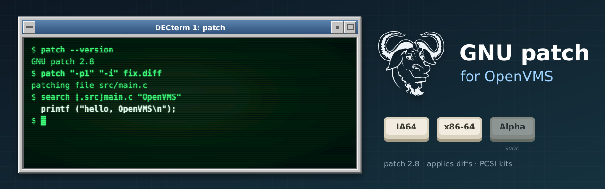

<p align="center">
  
</p>

# GNU patch for OpenVMS

[](https://github.com/issinoho/vms-patch/releases/latest)
[](https://github.com/issinoho/vms-patch/releases)

[](COPYING)

[GNU patch](https://www.gnu.org/software/patch/) (**2.8**), which applies a diff to the original
files, built natively for OpenVMS on **IA64**, **x86-64** and **Alpha**, following patch's own releases.
[GNU diffutils for OpenVMS](https://github.com/issinoho/vms-diffutils) makes the diffs. It belongs
to the same family as [GNU grep](https://github.com/issinoho/vms-grep),
[GNU sed](https://github.com/issinoho/vms-sed), [GNU awk](https://github.com/issinoho/vms-awk),
[GNU make](https://github.com/issinoho/vms-make),
[GNU diffutils](https://github.com/issinoho/vms-diffutils),
[GNU m4](https://github.com/issinoho/vms-m4), [GNU Bison](https://github.com/issinoho/vms-bison),
[flex](https://github.com/issinoho/vms-flex), [GNU Wget](https://github.com/issinoho/vms-wget),
[curl](https://github.com/issinoho/vms-curl), [PCRE2](https://github.com/issinoho/vms-pcre2),
[zlib](https://github.com/issinoho/vms-zlib), [bzip2](https://github.com/issinoho/vms-bzip2),
[XZ Utils](https://github.com/issinoho/vms-xz), [Zstandard](https://github.com/issinoho/vms-zstd)
and [MariaDB](https://github.com/issinoho/vms-mariadb) for OpenVMS.

This repository holds **only our changes**: every build starts from the signed GNU release
tarball (Andreas Gruenbacher's key, pinned in `keys/`), applies our patches and adds our VMS
files. As for grep, sed and m4, patch's own `configure` runs on a Linux host with every
compile and link test sent to VSI C on the node, and MMS builds the result.

## Status

**Released: [v2.8-vms1](https://github.com/issinoho/vms-patch/releases/tag/v2.8-vms1).**

| | IA64 (OpenVMS V8.4-2L3, VSI C 7.4) | x86-64 (OpenVMS E9.2-4, VSI C 7.7) |
|---|---|---|
| VSI C configure answers (identical on both) | yes | yes |
| Builds | yes | yes |
| Smoke test: unified and context diffs, `-R`, `-b` backups, `--dry-run`, a failing hunk (error status and `.rej`), `-p1` into a subdirectory, a missing patch file | 8/8 | 8/8 |
| Kit install, smoke test on the installed image, remove | clean | clean |
| PCSI kit (`PATCH`, `V2.8-0E1`) | `ISSINOHO-I64VMS-PATCH-V0208-0E1-1.PCSI` | `ISSINOHO-X86VMS-PATCH-V0208-0E1-1.PCSI` |

**Alpha (v2.8-vms2, a dedicated Alpha release; IA64 and x86-64 stay on vms1):** built on
OpenVMS Alpha V8.4-2L2 with VSI C V7.4-002 (86 `%CC-I-QUESTCOMPARE` and 2 `QUESTCOMPARE1`
informational messages; 8 `%CC-W-UNSUPCONVSPEC` warnings: the compiler says the C RTL does not
fully support `%td`, which patch uses for line numbers in hunk headers, and a probe and a failing
normal-diff hunk printed them correctly; one `%CC-W-INTOVERFL` in gnulib's date parser, a
constant in an overflow check, whose results a probe checked at the limits); DCL smoke test 8/8;
kit `ISSINOHO-AXPVMS-PATCH-V0208-0E2-1.PCSI`. The Alpha shares the IA64-derived `config.h`,
checked by compiling, linking and preprocessing all 376 test programs of the IA64 configure run
on the node (same verdict for every one) plus a run-time probe; see
`overlay/vms/config/vms-manual.site`. patch's own test suite needs GNV, which the Alpha node
does not have, so only the smoke test runs there.

**Requirements:** OpenVMS IA64, x86-64 or Alpha with VSI C and MMS (tested on IA64 V8.4-2L3
with VSI C 7.4, x86-64 E9.2-4 with VSI C 7.7, and Alpha V8.4-2L2 with VSI C V7.4-002). On the
host: git, bash, python3, gcc and make, curl, gpg, groff, and ssh/sftp for the automated route.
GNV for patch's own test suite (not available on the Alpha node).

## Installing the kit

Download the kit for your architecture from the
[latest release](https://github.com/issinoho/vms-patch/releases/latest) and check it against
the release's `SHA256SUMS`. A kit downloaded through a non-VMS system loses its record
format, so restore that first, then install it:

```
$ SET FILE/ATTRIBUTE=(RFM:FIX,LRL:8192,MRS:8192,RAT:NONE) ISSINOHO-*-PATCH-V0208-0E1-1.PCSI
$ PRODUCT INSTALL PATCH /PRODUCER=ISSINOHO /SOURCE=dev:[dir]
$ @PATCH$ROOT:[000000]PATCH$SETUP.COM
$ patch "-p1" "-i" fix.diff
```

It installs `[PATCH.BIN]PATCH.EXE`, `PATCH$SETUP.COM` (defines the `patch` command), the
manual page (`PATCH.TXT`, `PATCH.1`), `NEWS`, `COPYING` and `README.VMS` in `[PATCH.DOC]`,
and `SYS$STARTUP:PATCH$STARTUP.COM`, which defines `PATCH$ROOT` (add it to
`SYS$MANAGER:SYSTARTUP_VMS.COM`). `PRODUCT REMOVE PATCH` removes it.

## On VMS

- **File names** in a diff are Unix-style and relative to the current directory:
  `src/main.c` is `[.SRC]MAIN.C`. Backups (`-b`) and rejects keep patch's Unix names,
  `main.c.orig` and `main.c.rej`, which need an ODS-5 disk.
- **Exit status.** Under DCL failed hunks (exit code 1) and trouble (2) are errors, so
  `ON ERROR` and `IF .NOT. $STATUS` work. Under a GNV shell, `$?` is the exit code as on
  Unix.
- **Not available:** ed-style diffs (`diff -e`), which patch applies by running the Unix
  `ed` editor, and getting files from RCS or SCCS before patching them.
- **Upper-case options in batch jobs.** Under the TRADITIONAL DCL parse style unquoted
  options reach patch in lower case: `-R` (reverse) becomes `-r` (reject file). Use the long
  options (`--reverse`), quote the short ones (`"-R"`), or
  `$ SET PROCESS/PARSE_STYLE=EXTENDED` first.

## Patches

| Patch | Purpose |
|---|---|
| 0001 | `lib/scratch_buffer.h`: include the generated `*.gl.h` header as `*_gl.h` (VSI C cannot include a name with two dots). |
| 0002 | `lib/getprogname.c`: VMS implementation. |
| 0003 | `lib/malloc/scratch_buffer.h`: avoid the member name `__align`, a VSI C keyword. |
| 0004 | `lib/stdlib.in.h`: route `exit()` through `vms_exit()` for an error-severity status under DCL. |
| 0005 | `config.hin`: let `<assert.h>` define `assert` again (VSI C's header guard). |
| 0006 | `src/safe.c`: no `getrlimit()` on VMS; a fixed size for the directory cache. |
| 0007 | `src/common.h`: `readonly` is a VSI C keyword; rename the identifier. |
| 0008 | `lib/open.c`: open a directory through gnulib's fallback. |
| 0009 | `src/patch.c`: plain file names (the `openat()` emulation failed to set the output file's mode; absolute names and `..` are still refused); the program name `patch` in messages. |

0001-0005 are the gnulib fixes of the m4, sed and Bison ports; 0008 is vms-grep's.

## How to build

Set up `tools/nodes.conf` as described in
[vms-grep's README](https://github.com/issinoho/vms-grep#2b-build-on-vms-from-the-host-over-ssh).

```sh
git clone https://github.com/issinoho/vms-patch.git
cd vms-patch
tools/vms_configure.sh ia64 # VSI C configure run, about an hour (once per release; the Alpha reuses the IA64 answers)
tools/prepare.sh            # fetch + verify, patch, configure with the VSI C answers, MMS lists
tools/build.sh ia64         # upload, then @[.VMS]BUILD on the node (MMS); ia64, x86 or alpha (batch job)
tools/test.sh ia64          # smoke test
tools/kit.sh ia64           # PCSI kit -> out/kits/
```

## Roadmap

1. patch's own test suite under GNV, as for grep and sed.
2. Offer patches 0006, 0007 and 0009 to GNU patch, and the gnulib fixes to gnulib.
3. ~~A port to OpenVMS **Alpha**.~~ Done: see Status (Alpha kit, patch level 2).

## The family

This port is one of a family of ports and tools for OpenVMS, each following its upstream
releases. [openvms.issinoho.com](https://openvms.issinoho.com) lists them all, with the
newest kit for each architecture taken from their GitHub releases.

## Artwork

`docs/images/banner.svg` and `docs/images/icon.svg` were made for this project in the style
of classic DECwindows and VT terminals, like those of its sibling ports. The GNU head is by
Aurelio A. Heckert, used under the terms on <https://www.gnu.org/graphics/heckert_gnu.html>.

## Licence

GNU patch is free software under the GNU General Public License, version 3 or later; see
`COPYING`. Our patches and VMS files are distributed under the same terms.

OpenVMS is a trademark of VMS Software, Inc. This project is not affiliated with VMS
Software, Inc. or with the GNU project.
